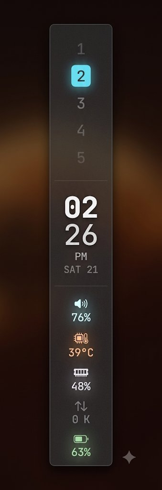
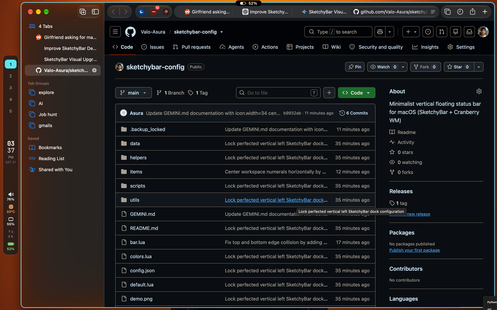

# SketchyBar Minimalist Vertical Dock

A sleek, frosted-glass vertical floating status bar for macOS powered by [SketchyBar](https://github.com/FelixKratz/SketchyBar) and integrated seamlessly with the [yabai](https://github.com/koekeishiya/yabai) tiling window manager.

<p align="center">
  
</p>

### Full Desktop Overview
<p align="center">
  
</p>

---

## Highlights & Features

- **Frosted Glass Floating Capsule (`position = "left"`)**:
  - Anchored on the left edge of the screen (`height = 46` width, `y_offset = 160`, `margin = 8`).
  - Dark translucent glass background (`0xc81c1a19`) with `blur_radius = 30`, `corner_radius = 12`, and a subtle 1px border (`0x28ffffff`).
  - 12px breathing room padding at the top and bottom pill caps.
- **Tiling Window Manager Synergy (`yabai` + `skhd` + `borders`)**:
  - Gaps and padding tuned for zero window overlap (`left_padding 62`, `window_gap 8`).
- **Interactive Workspace Switcher (1–5)**:
  - Inactive spaces: muted gray numerals (`0x77ffffff`).
  - Active space: centered rounded cyan rectangle (`34x26px`, `corner_radius = 8`, `#5de4f0`) with bold charcoal text (`#0b1215`).
  - Click any number or switch spaces via yabai / skhd to dynamically update focus.
- **Vertically Stacked Typography Clock**:
  - Centered typographic hierarchy:
    - **Hour**: Bold 18pt bright white (`#f5f5f5`)
    - **Minute**: Medium 18pt soft white (`#d4d4d8`)
    - **AM/PM**: Regular 10pt muted gray (`#9ca3af`)
    - **Day & Date**: Regular 9pt muted gray (`#71717a`)
- **Semantic System Statistics**:
  - Vertical icon-above-value layout with semantic color coding:
    - 􀊧 **Volume**: Soft ice-cyan (`#d6f4f7`)
    - 􀧓 **CPU Temperature**: Warm amber (`#e89e64`) reading live Apple Silicon SMC sensors via native C helper
    - 􀫦 **RAM Utilization**: Clean white (`#e5e7eb`)
    - ↑↓ **Network Speed**: Dim gray (`#7a7a80`)
    - 􀛨 **Battery**: Soft green (`#7ee081`) with dynamic amber (<30%) and red (<15%) state transitions

---

## Requirements & Fonts

- macOS 13+ (Apple Silicon supported)
- [SketchyBar](https://github.com/FelixKratz/SketchyBar)
- [yabai](https://github.com/koekeishiya/yabai) & [skhd](https://github.com/koekeishiya/skhd)
- [JankyBorders](https://github.com/FelixKratz/JankyBorders)
- Fonts:
  - **SF Pro** (Apple system font / SF Pro Display)
  - **JetBrainsMono Nerd Font** (for monospace numerals and icons)

---

## Installation & Setup

1. **Install Window Manager Stack**:
   ```bash
   brew tap koekeishiya/formulae
   brew tap felixkratz/formulae
   brew install sketchybar yabai skhd borders
   ```

2. **Clone Configuration**:
   ```bash
   git clone https://github.com/Valo-Asura/sketchybar-config.git ~/.config/sketchybar
   ```

3. **Build Helper Binaries** (for CPU load and network events):
   ```bash
   cd ~/.config/sketchybar/helpers && make
   ```

4. **Start Services**:
   ```bash
   sketchybar --reload
   yabai --start-service
   skhd --start-service
   brew services start borders
   ```

---

## License

MIT
